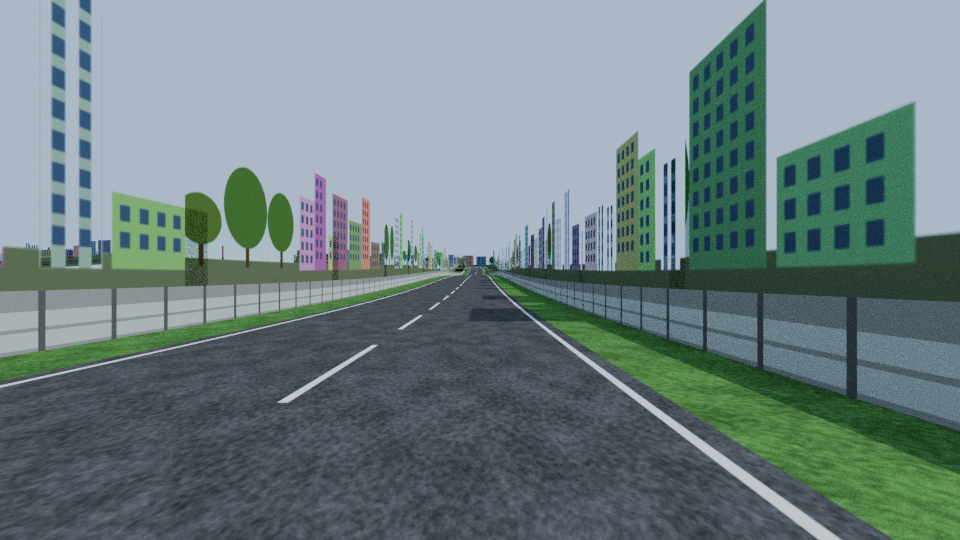

# sv2ac — Street View → Assetto Corsa

Pick a route on a map (or feed it a GPX/KML), and sv2ac builds an Assetto Corsa
track from it: real road geometry, real elevation, and roadside scenery made from
Google Street View photos.


<sub>Blender render of a track built in `--offline` mode (procedural stand-in scenery instead of real Street View photos).</sub>

## What you get

```
tracks/<track_id>/
├── data/surfaces.ini      ROAD / GRASS / KERB physics surfaces
├── data/map.ini, map.png  minimap for the in-game map app
├── ui/ui_track.json       name, length, pitboxes, geotags…
├── ui/preview.png         Street View shot of the start line
├── ui/outline.png
├── NEXT_STEPS.txt         how to finish the build (below)
└── source/
    ├── <track_id>.obj/.mtl   the 3D scene, AC-named objects, metres, Y-up
    ├── textures/             asphalt/grass/barrier + Street View atlases
    ├── scene.json            spawn & timing empties (AC_START_n, AC_PIT_n, AC_TIME_0_L/R …)
    └── blender_build_fbx.py  turns the OBJ + empties into an FBX for ksEditor
```

Scene objects follow AC's naming conventions so physics works out of the box:

| Object            | What it is                                             |
|-------------------|--------------------------------------------------------|
| `1ROAD_nnn`       | drivable asphalt ribbon (with centre & edge lines)     |
| `1GRASS_L/R_nnn`  | grass verges (slow, off-track)                         |
| `1WALL_L/R_nnn`   | barriers either side (collision)                       |
| `GROUND_L/R_nnn`  | visual terrain out to the scenery                      |
| `SV_PANELS_nn`    | Street View photo walls lining the road                |

Every object is chunked to stay under the KN5 65k-vertex limit.

## How it works

1. **Route** – waypoints are snapped to drivable roads with the Google
   **Routes API** (or used as-is with `--no-follow-roads`, e.g. for GPS traces).
2. **Centreline** – projected to local metres, resampled every 1 m, smoothed,
   then resampled to the mesh spacing (2 m default).
3. **Elevation** – the **Elevation API** is sampled every 10 m, interpolated and
   smoothed so the road surface isn't bumpy from DEM noise.
4. **Street View** – every 25 m the free metadata endpoint finds the nearest
   panorama, then the **Street View Static API** fetches one image looking left
   and one looking right. The field of view and crop are computed so that each
   image, pasted onto a wall at distance *D* from the road, lines up in
   perspective with what you'd see from the driving line (camera height 2.5 m).
   The sky is masked out so AC's own sky shows above the buildings.
5. **Meshes** – road, verges, barriers, ground and photo walls are extruded
   along the centreline. Offsets are pulled in on tight bends so meshes never
   fold over themselves.
6. **Layout** – for loops, the start/finish line is placed automatically on the
   straightest stretch long enough for the grid; spawn points alternate across
   the road. Point-to-point stages get `AC_AB_START/FINISH` gates.

## Setup

```bash
pip install -r requirements.txt          # numpy + Pillow; Python 3.10+
export GOOGLE_MAPS_API_KEY=...           # Google Cloud project with billing
```

Enable these APIs on the key: **Routes API**, **Elevation API**,
**Street View Static API**.

Rough cost: Street View images are the main expense (≈ $7 per 1000). At the
default 25 m spacing that's 80 images per km — about **$0.56/km**, plus a few
cents of routing/elevation. Metadata lookups are free. Everything is cached in
`tracks/_cache/`, so rebuilding with different options costs nothing.
`--max-images` (default 1000) is a hard cap.

## Usage

### Web UI

```bash
python -m sv2ac serve            # http://127.0.0.1:8765
```

Click to drop waypoints, drag to adjust, right-click to delete (or paste
coordinates), set options, **Build track**, then download the zip. The page
shows a running length and Street View cost estimate. Without an API key it
runs in offline demo mode.

### Command line

```bash
# Closed loop from waypoints
python -m sv2ac build --name "Monaco Streets" \
  --waypoints "43.7384,7.4246; 43.7402,7.4270; 43.7416,7.4239; 43.7395,7.4215" \
  --country Monaco --zip

# Point-to-point mountain stage from a GPX trace
python -m sv2ac build --name "Stelvio" --file stelvio.gpx --point-to-point --road-width 7

# Try the whole pipeline without an API key (synthetic elevation & scenery)
python -m sv2ac build --name "Demo" --offline \
  --waypoints "51.5007,-0.1246; 51.5035,-0.1195; 51.5065,-0.1270; 51.5030,-0.1320"
```

Useful options: `--road-width`, `--shoulder`, `--sv-spacing`, `--smoothing`,
`--pitboxes`, `--no-sky-mask`, `--flip-start`, `--max-images`. See
`python -m sv2ac build -h`.

## Getting it into the game

AC loads tracks as `.kn5`, which is produced by Kunos' **ksEditor** (part of
the free Assetto Corsa SDK). The generated `NEXT_STEPS.txt` walks through it:

1. `blender -b --python source/blender_build_fbx.py -- source`
   (Blender 3.6+; adds the `AC_*` empties and writes `source/<id>.fbx`)
2. In ksEditor: import the FBX, set shaders (`ksPerPixel` for base materials,
   `ksPerPixelAT` for the `sv_atlas_*` photo walls so the sky cut-out works),
   save the KN5 as `<track_id>.kn5` in the track folder.
3. Copy the folder to `assettocorsa/content/tracks/`.
4. Drive a lap to record an AI line if you want AI opponents and replay cameras.

## Limitations

- The scenery is **photo walls**, not a reconstructed 3D city: it looks right
  from the driving line and flat from other angles. Panels at junctions and
  where Street View has no coverage are left empty.
- Elevation comes from Google's terrain model (~10–30 m resolution); bridges,
  tunnels and multi-level roads will be wrong.
- Road width is constant; no kerbs, pit lane or run-off areas are generated.
- No AI line / replay cameras – record those in-game.
- Generated in AC's conventions (Y-up, spawn empties' +Z = driving direction).
  If cars ever spawn facing backwards in your setup, rebuild with `--flip-start`.

## Legal

Street View imagery is © Google and its use is governed by the
[Google Maps Platform Terms of Service](https://cloud.google.com/maps-platform/terms),
which restrict caching, extracting and redistributing content. Keep tracks built
with real imagery for personal use and don't publish them on mod sites. The
offline mode and all code-generated textures carry no such restriction.

## Tests

```bash
pip install pytest && python -m pytest tests
```

The tests build complete tracks offline and against a mocked Google API, and
check object naming, the KN5 vertex limit, face orientation, spawn placement
and minimap scaling.
